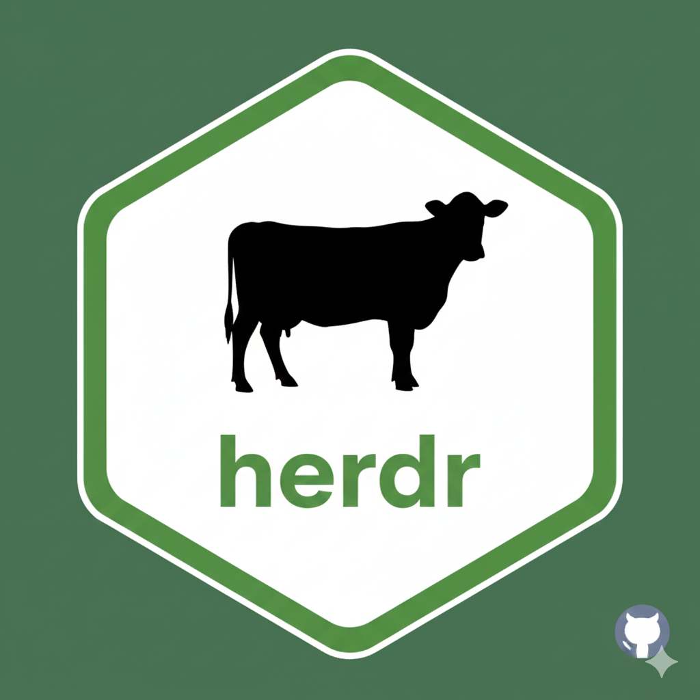

------------------------------------------------------------------------

# herdr 

[](https://www.repostatus.org/#active) [](https://github.com/JuanCBM99/herdr/actions/workflows/build.yaml) [](https://github.com/JuanCBM99/herdr/actions/workflows/docs.yaml) [](https://codecov.io/gh/JuanCBM99/herdr) [](https://github.com/JuanCBM99/herdr/actions/workflows/test-coverage.yaml) [](https://www.youtube.com/watch?v=wmGIQ3g-ZFk) [](https://www.r-project.org/)

------------------------------------------------------------------------

# 🌱 herdr: Greenhouse Gas Emissions & Land Use Assessment for Livestock

**herdr** is an R package for estimating **greenhouse gas (GHG) emissions**, **feed-related land use**, and **livestock production** from livestock production systems using **IPCC Tier 2** methodologies.

The package currently supports:

- 🐄 Cattle
- 🐑 Sheep
- 🐐 Goats
- 🐖 Swine
- 🐔 Poultry

It provides estimates of:

- Enteric methane ($\text{CH}_4$)
- Methane from manure management ($\text{CH}_4$)
- Direct and indirect nitrous oxide emissions ($\text{N}_2\text{O}$)
- Upstream feed carbon footprint — fossil vs. land-use change / deforestation ($\text{CO}_2\text{e}$, ECOALIM v9 / EF 3.1)
- Feed freshwater deprivation ($\text{m}^3\text{ depriv.}$, AWARE model)
- Feed-related land use & agroecological competition ($\text{m}^2$, Mottet et al. 2017)
- Milk (FPCM), carcass meat, fresh eggs, greasy wool, edible human protein, and Protein FCRs

------------------------------------------------------------------------

# 🌐 Web Interface (No R or installation required!)

You don't need to be a programmer or have R installed to use **herdr**. A fully interactive web application allows users to estimate greenhouse gas emissions, calculate feed-related land use, modify diets, and export results directly from a web browser.

👉 **Launch the herdr Web Interface:**\
[**https://juancbm99.shinyapps.io/herdr/**](https://juancbm99.shinyapps.io/herdr/)

> **Note:** The web application performs all calculations in the background and does not require any software installation or local datasets.

------------------------------------------------------------------------

# 📺 Video Tutorial

A complete walkthrough covering installation, project setup, input files, and running your first assessment is available on YouTube.

👉 <https://youtu.be/wmGIQ3g-ZFk>

------------------------------------------------------------------------

# 💻 Prerequisites (For Local Installation)

To use **herdr** locally, first install both **R** and **RStudio**.

## Install R

<https://cran.r-project.org/>

## Install RStudio

<https://posit.co/download/rstudio-desktop/>

------------------------------------------------------------------------

# 🚀 Installation

Install the development version directly from GitHub.

``` r
if (!requireNamespace("remotes", quietly = TRUE))
  install.packages("remotes")

remotes::install_github("JuanCBM99/herdr")

library(herdr)
```

------------------------------------------------------------------------

# 🖥️ Launch the Interactive Application

Once the package has been installed, launch the graphical interface directly from R.

``` r
library(herdr)

run_herdr_app()
```

------------------------------------------------------------------------

# ⚡ Quick Start (Command Line)

## 1. Initialize a new project

``` r
herdr_init()
```

## 2. Run the assessment

``` r
results <- generate_impact_assessment(
  farm_country = "Spain",
  year = 2024,
  gwp_report = "AR5"
)

# Table 1: Absolute cohort inventory & per-head footprints
results$totals

# Table 2: Enterprise-integrated product & protein intensities
results$intensities
```

> **Important:** The first time an assessment requires feed origin allocation, **herdr** automatically downloads the required FAO background dataset (\~187 MB). This download occurs only once and is reused in future analyses.

Output files are automatically saved in the `output/` directory.

------------------------------------------------------------------------

# ✨ Main Features

- 🌐 Interactive web interface requiring no programming experience.
- 📖 Full implementation of the **IPCC 2019 Refinement (Tier 2)** methodology.
- 🐄 Support for both ruminant and monogastric livestock.
- 🐖 FEDNA-based energy requirement equations for swine and poultry.
- 🔄 Automatic herd demography modeling (`automatic_cycle = TRUE`).
- ⚡ Automatic calculation of:
  - Gross Energy (GE)
  - Dry Matter Intake (DMI)
  - Volatile Solids (VS)
  - Nitrogen intake, retention and excretion
- 🌿 Enteric methane ($\text{CH}_4$) emissions.
- ♻️ Manure methane ($\text{CH}_4$) emissions.
- 🌱 Direct and indirect nitrous oxide ($\text{N}_2\text{O}$) emissions.
- 🏭 Upstream feed LCA (fossil vs. LUC deforestation $\text{CO}_2\text{e}$) and **AWARE** water deprivation ($\text{m}^3\text{ depriv.}$) via **ECOALIM v9 / AGRIBALYSE v3.1 (EF 3.1)**.
- 🌾 Feed-related land use & human food competition (Mottet et al., 2017) using:
  - FAOSTAT crop yields (`cropland`, `grassland_convertible`, `grassland_unconvertible`)
  - Curated national forage yield databases (`forages.parquet`)
  - Dynamic FAO bilateral trade allocation matrix
  - 70% domestic self-sufficiency allocation rule
- 🥩 Milk (FPCM), meat (carcass & boneless), egg, wool, and edible human protein outputs, with **IDF (2022)** biophysical co-product allocation and **Mottet (2017)** Protein FCRs.
- 🧩 Modular workflow allowing both individual calculations and complete assessments.
- 📄 Transparent CSV-based input files that can easily be modified by users.

------------------------------------------------------------------------

# 📚 Documentation

Complete documentation, theoretical background, workflow guides, and examples are available at:

<https://juancbm99.github.io/herdr/>

------------------------------------------------------------------------

# 📖 Methodology

**herdr** follows the methodologies described in:

> **2019 Refinement to the 2006 IPCC Guidelines for National Greenhouse Gas Inventories**
>
> Volume 4 — Agriculture, Forestry and Other Land Use (AFOLU)
>
> Chapter 10 — Emissions from Livestock and Manure Management.

Energy requirement equations for swine and poultry follow the **FEDNA** methodology published by the Spanish Ministry of Agriculture.

------------------------------------------------------------------------

# 🤝 Contributing

Contributions are welcome.

If you encounter a bug, identify an error, or have suggestions for improvements, please open an issue or submit a pull request.

------------------------------------------------------------------------

# 📄 License

This project is distributed under the **MIT License**.

See the `LICENSE` file for details.
